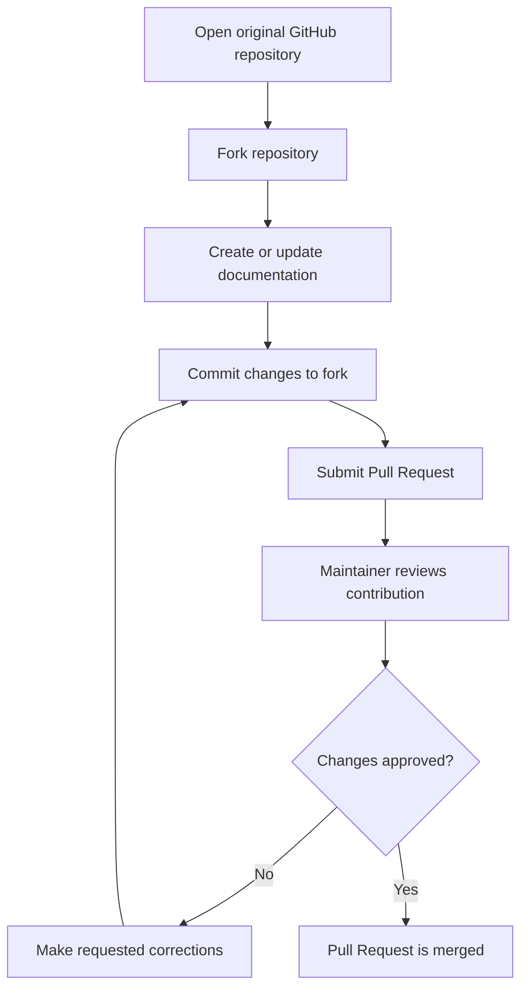

Open-Source Software Engineering
Student Details
Name: Mayank Nigam
USN: NB25CSE207
Assigned Case Study: Open-Source Software Engineering
1. Introduction
Open-source software engineering is the process of developing and improving software whose source code is publicly available. Developers can study the code, use it, modify it, and contribute improvements according to the project's licence and contribution guidelines.
Platforms such as GitHub support collaboration by allowing developers to share code, report issues, review changes, and submit contributions through pull requests.
2. Problem Analysis
A group of developers maintains an open-source Library Management System on GitHub. A student notices that the project does not contain clear documentation explaining how users can issue and return books.
This creates problems for users:
New users may not understand how to issue a book.
Users may be unsure how to return a borrowed book.
Incorrect use of the system may lead to confusion and support requests.
Developers may need to repeatedly answer the same questions.
The project therefore needs clear and accurate documentation describing the book issue and return procedures.
3. Proposed Solution
The student can improve the project by creating or updating a Markdown documentation file, for example, `BOOK_ISSUE_RETURN.md`.
The document should explain the following procedures.
A. Issuing a Book
Open the Library Management System.
Sign in using a valid user account.
Search for the required book by title, author, or book ID.
Check whether the book is available.
Select the issue or borrow option.
Confirm the request.
Check the account or transaction page for the issue details and due date.
B. Returning a Book
Sign in to the system.
Open the borrowed-books or issued-books section.
Identify the book that must be returned.
Select the return option.
Confirm the return.
Verify that the book status has changed to returned.
Note: These are proposed documentation steps. The exact labels and screens should be adjusted to match the actual project.
4. GitHub Contribution Workflow
The student can contribute to the open-source project using the following steps:
Step 1: Fork the Repository
Open the original Library Management System repository on GitHub.
Click Fork.
Select the student's GitHub account as the owner.
Create the fork.
A fork creates a copy of the original repository under the student's account.
Step 2: Create or Update the Documentation File
Open the forked repository.
Navigate to the appropriate documentation folder.
Create `BOOK_ISSUE_RETURN.md`, or update the existing documentation file.
Add clear instructions for issuing and returning books.
Preview the Markdown content and check it for accuracy.
Step 3: Commit the Changes
Save the file.
Click Commit changes.
Use a meaningful commit message, such as `Added book issue and return documentation`.
Commit the changes to the fork's `main` branch, unless the project specifies another branch.
A commit records the changes made to the repository.
Step 4: Submit a Pull Request
Open the student's fork on GitHub.
Select Contribute and then Open pull request (or use the Pull requests tab).
Check that the base repository is the original project and the head repository is the student's fork.
Add a title such as `Improve book issue and return documentation`.
Describe the documentation changes.
Click Create pull request.
A pull request asks the original project maintainers to review and merge the contribution.
Step 5: Review and Merge
The maintainers review the proposed changes.
They may request corrections.
The student makes any requested updates and commits them.
Once approved, a maintainer merges the pull request into the original repository.
5. GitHub Contribution Workflow Diagram

6. Benefits of Contributing to Open-Source Projects
Better documentation: Clear instructions make the software easier to use.
Collaboration: Developers can work together and review one another's contributions.
Learning: Students gain practical experience with Git, GitHub, Markdown, and version control.
Quality improvement: Review and feedback help identify mistakes and improve project quality.
Community support: Useful contributions benefit users and developers beyond the original team.
7. Conclusion
Improving the Library Management System's documentation is a useful open-source contribution. By explaining how to issue and return books, the student makes the software easier to understand and use. The GitHub workflow of forking, editing, committing, and submitting a pull request provides a structured way to contribute changes. This process also helps students develop collaboration, documentation, and version-control skills.
8. References
GitHub Docs: Fork a repository
GitHub Docs: About pull requests
GitHub Docs: Getting started with Git
