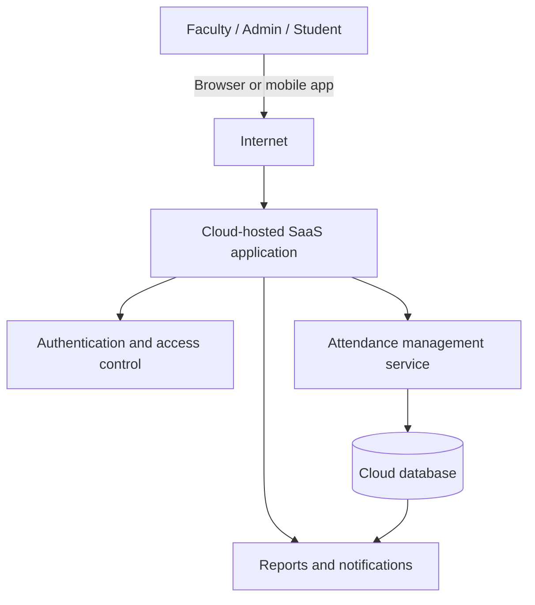

# SaaS-Based College Attendance Management System

## Software Engineering – Open Source Contribution

### Student Details
- **Name:** Manjunath Patil
- **USN:** NB25CSE203
- **Selected Case Study:** Question 1 – SaaS and Cloud-Based Applications

## Project Overview
This project proposes a cloud-based attendance management system for a college. It replaces manual attendance registers and separate Excel sheets with a centralized system that faculty members can access through the internet.

## Objectives
- Allow faculty to mark attendance online.
- Store attendance records in a centralized cloud database.
- Calculate attendance percentages automatically.
- Allow authorized students and faculty to view attendance information.
- Generate attendance reports and notifications.

## Main Features
1. Secure login with role-based access for administrators, faculty, and students.
2. Student, class, and subject management.
3. Digital attendance marking.
4. Automatic attendance percentage calculation.
5. Attendance reports and low-attendance notifications.
6. Centralized cloud storage.

## Proposed Architecture



## Benefits
- **Anywhere access:** Faculty can use the system from any location with an internet connection.
- **Real-time updates:** Authorized users can view updated attendance records.
- **Reduced maintenance:** The SaaS provider manages hosting, updates, and much of the infrastructure.

## Challenges
- **Internet dependency:** Poor connectivity or an outage can interrupt access.
- **Data security and privacy:** Student records must be protected using secure authentication, access permissions, encryption, and backups.

## Repository Structure

```text
.
├── README.md
└── contributions/
    └── NB25CSE203_SaaS_Attendance_System.md
```

## Open-Source Contribution Workflow
1. Fork the faculty repository.
2. Add the individual answer file inside the `contributions/` folder.
3. Commit the changes to the forked repository.
4. Open a Pull Request to the faculty repository.
5. Share the Pull Request URL as submission evidence.

## Conclusion
A SaaS-based attendance management system can make attendance recording faster, more accessible, and easier to manage. Reliable internet access and strong data security controls are important for successful implementation.
