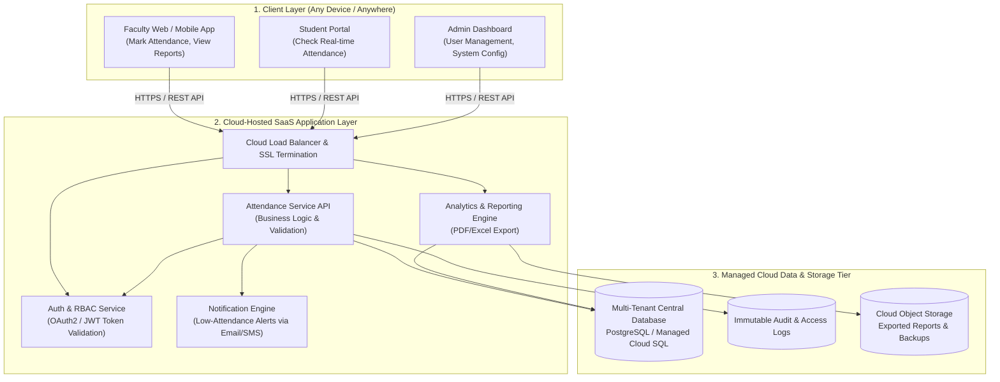

# Cloud-Based SaaS Student Attendance Management System

## 1. Student Details

| Field | Information |
| :--- | :--- |
| **Student Name** | Devesh Kolte |
| **USN** | NB25CSE097 |
| **Course / Subject** | Software Engineering & Architecture (SEA) |
| **Activity** | Unit 5 – Open Source Contribution Project (LA-2) |
| **Assigned Case Study** | Question 1: SaaS and Cloud-Based Applications |

---

## 2. Introduction

**Software as a Service (SaaS)** is a cloud computing delivery model in which software applications are centrally hosted on cloud infrastructure, maintained by a service provider, and accessed by end users via a web browser or mobile client over the internet. Unlike traditional on-premise software or standalone desktop tools (such as offline spreadsheets), SaaS eliminates the need for individual installations, manual patch management, and localized data storage.

In the context of higher education institutions, moving core administrative workflows—such as attendance monitoring—to a SaaS model shifts the institutional burden from hardware provisioning and manual record keeping to an agile, subscription-ready service. The software vendor handles high availability, database scaling, automated security updates, and automated backups, allowing academic staff and administration to focus solely on educational delivery.

---

## 3. Problem Analysis

The institution currently relies on conventional paper registers and fragmented Excel spreadsheets to log and calculate student attendance. This traditional setup introduces several acute operational bottlenecks:

1. **Manual Inefficiencies & Time Overhead:** Faculty members spend considerable lecture time manually passing registers or calling out roll numbers, followed by hours transcribing numbers into personal Excel files.
2. **Data Fragmentation and Silos:** When attendance data resides in offline files across individual faculty laptops, there is no single source of truth. Discrepancies arise frequently between department records, exam offices, and individual faculty sheets.
3. **Lack of Ubiquitous Access:** Faculty cannot update or access attendance records from outside the campus local network or away from their specific office workstation.
4. **Delayed Intervention for Shortage Cases:** Academic regulations mandate threshold attendance (e.g., 75% or 85%). With manual records, identifying students falling below this threshold usually occurs only at the end of the semester, eliminating opportunities for timely academic mentoring or parental alerts.
5. **Physical Risk & Loss of Audit Trail:** Physical registers are prone to damage, wear, loss, or unauthorized tampering, offering virtually no audit trail of who made changes, when, or why.

---

## 4. Proposed Solution

### 4.1 System Overview
The proposed solution is a **Multi-Tenant SaaS Attendance Management System** deployed on modern cloud infrastructure. The application leverages a secure web interface backed by scalable REST APIs and a managed cloud database. Faculty members can mark and manage attendance on the go from any device (laptop, tablet, smartphone), while students and administrators have dedicated portals for real-time visibility and reporting.

### 4.2 Essential Features (Minimum Four Required)

The SaaS attendance platform is architected around the following core features:

1. **Role-Based Access Control (RBAC) & Secure Authentication:**
   - Dedicated permission profiles for **Administrators**, **Faculty/Instructors**, and **Students**.
   - Single Sign-On (SSO) integration with institutional email credentials (e.g., OAuth2 / SAML) to prevent unauthorized access.
   - Fine-grained authorization: Instructors only have edit rights for their assigned course sections, while students have read-only access strictly to their personal records.

2. **Digital Attendance Roster & Rapid Marking:**
   - Dynamic class-list loading with one-click "Mark All Present" default, allowing quick toggle of absentees to minimize classroom disruption.
   - Automatic session timestamping, slot tracking, and optional geo-fencing or proxy-prevention validation.

3. **Centralized Real-Time Analytics & Shortage Alert Engine:**
   - Automated computation of cumulative attendance percentages for every student across subjects.
   - Configurable alert triggers: When a student's attendance falls below the statutory threshold (e.g., 75%), automated SMS/email alerts are dispatched to the student, mentor, and parents.

4. **Automated Report Generation & Academic Export:**
   - Instant export of compliance reports, semester attendance summaries, and eligibility lists in PDF, CSV, and Excel formats.
   - Direct integration hooks for the College ERP and Controller of Examinations (CoE) grading portals.

---

### 4.3 System Architecture Diagram

The system follows a three-tier cloud SaaS architecture comprising a Client Layer, a Cloud Application & Services Layer, and a Managed Storage/Data Layer.

#### A. Interactive Mermaid Diagram


#### B. Text / ASCII Architectural Representation
```text
+-------------------------------------------------------------------------------+
|                             1. CLIENT LAYER                                   |
|   [Faculty Device]             [Student Portal]          [Admin Dashboard]    |
| (Mark Attendance/Reports)     (View Attendance)        (Config/User Mgmt)     |
+-------------------------------------------------------------------------------+
                                      |
                           HTTPS / TLS 1.3 Encryption
                                      v
+-------------------------------------------------------------------------------+
|                    2. CLOUD-HOSTED SaaS APPLICATION TIER                      |
|                  +-----------------------------------------+                  |
|                  |   Cloud Load Balancer & API Gateway     |                  |
|                  +-----------------------------------------+                  |
|                         |                     |                               |
|        +----------------+---+       +---------+----------+                    |
|        | Auth & RBAC Service|       | Attendance API Pod |                    |
|        | (JWT / OAuth2 SSO) |       | (Core Logic Engine)|                    |
|        +--------------------+       +--------------------+                    |
|                                               |                               |
|                     +-------------------------+-------------+                 |
|                     | Notification Engine  | Report Engine  |                 |
|                     | (SMS / Email Alerts) | (PDF / CSV)    |                 |
|                     +----------------------+----------------+                 |
+-------------------------------------------------------------------------------+
                                      |
                                      v
+-------------------------------------------------------------------------------+
|                      3. MANAGED CLOUD DATA & STORAGE TIER                     |
|  [(Central Database - PostgreSQL)]   [(Audit Logs)]   [(Cloud Storage)]       |
+-------------------------------------------------------------------------------+
```

#### Architecture Walkthrough:
1. **Client Layer:** Users interact with responsive web and progressive mobile interfaces over secure HTTPS from any device.
2. **Cloud SaaS Layer:** A managed Load Balancer distributes incoming requests across containerized microservices. Authentication is verified via JWT tokens. The Attendance API validates inputs, executes business rules, and triggers background notification queues for attendance alerts.
3. **Managed Data Tier:** Relational data is consolidated in a managed high-availability database cluster with automated replication, point-in-time recovery, and separated audit logging for security compliance.

---

## 5. Benefits and Challenges

### 5.1 Benefits of Cloud-Based Applications

#### 1. Ubiquitous Accessibility for Faculty and Students
- **For Faculty:** Instructors can mark attendance or review student records anywhere—inside lecture halls, labs, faculty cabins, or off-campus—without needing access to a specific desktop or paper log.
- **For Students:** Students gain 24/7 transparent access to their up-to-date attendance percentages directly from their personal mobile devices, eliminating confusion, misinformation, and the need to queue outside administrative offices.

#### 2. Centralized Single Source of Truth & Data Integrity
By transitioning from fragmented Excel files on individual computers to a unified cloud database, synchronization mismatches, data loss, and accidental overrides are eliminated. Any update made by a faculty member is instantly reflected across departmental dashboards, parent notification systems, and university examination records.

#### 3. Elastic Scalability and Zero On-Premise IT Maintenance
The institution does not need to invest capital in dedicated on-premise servers, power backups, or manual software installations across campus computers. The SaaS provider automatically handles capacity scaling during peak registration and semester-end periods, applies security patches, and maintains automated disaster recovery backups.

---

### 5.2 Possible Challenges and Mitigation Strategies

#### 1. Dependence on Continuous Internet Connectivity
- **Challenge:** If campus Wi-Fi or cellular networks experience sudden downtime, instructors may be temporarily unable to connect to the cloud endpoint to take attendance during class.
- **Mitigation Strategy:** Implement an **offline-first Progressive Web Application (PWA)** client with local browser storage (IndexedDB). Faculty can take attendance offline; the client queues the encrypted records locally and automatically synchronizes with the cloud server as soon as network connectivity is restored.

#### 2. Data Security, Privacy, and Multi-Tenant Isolation
- **Challenge:** Storing institutional student records and faculty information on shared public cloud infrastructure exposes risks of unauthorized access, data leaks, or insider tampering if security policies are misconfigured.
- **Mitigation Strategy:** Enforce end-to-end encryption (**TLS 1.3** for data in transit and **AES-256** for data at rest), mandate **Multi-Factor Authentication (MFA)** for administrative and faculty roles, adhere to strict multi-tenant **Row-Level Security (RLS)** in the database, and maintain automated immutable audit logs for every record modification.

---

## 6. Conclusion

Transitioning from manual physical registers and isolated Excel spreadsheets to a dedicated SaaS Attendance Management System resolves critical issues of human error, administrative delays, and lack of real-time visibility. By capitalizing on multi-tenant cloud architecture, automated shortage alerts, and role-based access control, the institution achieves an efficient, transparent, and scalable academic administration workflow. With built-in offline synchronization and industry-standard encryption practices, potential network and security hurdles can be effectively addressed, ensuring seamless institutional adoption.
