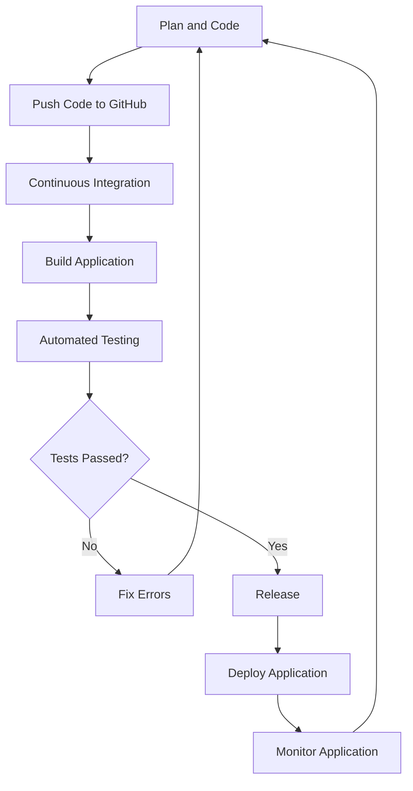

# DevOps Practices and CI/CD Pipelines

**Name:** Harshini P  
**USN:** NB25CSE141  
**Assigned Case Study:** Question 3 – DevOps Practices and CI/CD Pipelines

## 1. Introduction

DevOps is a combination of Development (Dev) and Operations (Ops) practices that aims to improve collaboration between software developers and IT operations teams. It focuses on automating software development, testing, integration and deployment to deliver reliable software faster.

Continuous Integration (CI) is the practice of frequently combining code changes from different developers into a shared repository. Each change is automatically built and tested to identify errors early.

Continuous Delivery (CD) ensures that tested software is always ready for release, while Continuous Deployment automatically releases every successfully tested change to production.

## 2. Problem Analysis

The given case study describes a software company developing an online shopping application. Developers frequently introduce new features and fix existing bugs.

However, the company faces several problems:

- Manual testing consumes considerable time.
- Manual deployment increases the possibility of human errors.
- Integration of code from different developers may create conflicts.
- Delayed releases affect the delivery of new features.
- Identifying and correcting errors becomes difficult when testing happens late.

Therefore, the company needs an automated approach to improve its development and deployment process.

## 3. Proposed Solution: DevOps and CI/CD Pipeline

The company can implement DevOps practices along with a CI/CD pipeline to automate the software development lifecycle.

The following stages can be used:

### 3.1 Plan and Code

Developers plan new features, fix bugs and write source code. The code is maintained in a shared version control system such as GitHub.

### 3.2 Build

Whenever developers push code changes, the CI tool automatically compiles the source code, resolves dependencies and creates a build package.

### 3.3 Test

Automated tests are executed to check whether the application works correctly. Unit testing, integration testing and functional testing help identify errors before release.

### 3.4 Release

After successful testing, the application is prepared for release. The build is stored as a release-ready version.

### 3.5 Deploy

The tested application is deployed to the production environment. With Continuous Deployment, this process can happen automatically after all required checks pass.

### 3.6 Monitor

The deployed application is continuously monitored for errors, performance issues and unexpected behaviour. Feedback is used to improve future updates.

## 4. CI/CD Pipeline Workflow

The following diagram represents the automated workflow for the online shopping application.

## 5. Explanation of Build, Test and Deployment

**Build:** The build stage converts source code into an executable or deployable package. It also checks whether the application can be compiled successfully.

**Test:** The testing stage automatically executes test cases to verify the functionality and reliability of the application. It helps detect bugs before the software reaches users.

**Deployment:** The deployment stage transfers the tested application to the production environment, making the latest features and bug fixes available to customers.

## 6. Benefits of Automation

1. **Faster Software Delivery:** Automated building, testing and deployment reduce manual work and help release updates quickly.

2. **Improved Software Quality:** Continuous testing identifies bugs early and reduces the chances of errors reaching users.

3. **Better Collaboration:** DevOps encourages communication between development and operations teams, making the development process more efficient.

## 7. Challenges of Implementing DevOps

1. **Initial Setup and Cost:** Setting up CI/CD tools, infrastructure and automation environments may require additional investment and technical knowledge.

2. **Learning and Cultural Changes:** Employees may need training to use automation tools and adapt to continuous collaboration and frequent software releases.

## 8. Conclusion

DevOps practices and CI/CD pipelines provide an effective solution to the challenges faced by the online shopping application development company. By automating the build, testing and deployment stages, the company can reduce manual errors, improve software quality and deliver new features faster. Continuous monitoring and collaboration further support reliable software development. Thus, adopting DevOps and CI/CD can make the software development process more efficient, consistent and scalable.
