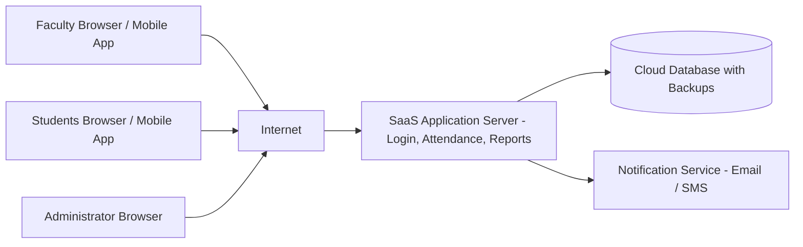

# Question 1 - SaaS and Cloud Based Applications

**Name:** I Pranava Keerthana
**USN:** NB25CSE147
**Assigned Case Study:** Question 1 - SaaS and Cloud Based Applications

---

## 1) Introduction

SaaS (Software as a Service) applications are web based. The software is stored on a server and accessed through a web browser or application, so the user does not have to install it on individual devices. The service provider looks after the servers, updates, security patches and backups. The user pays for this service through a subscription or a pay-as-you-go model.

Examples include Google Workspace, Zoom and Microsoft 365. SaaS sits higher in the cloud computing hierarchy than IaaS (Infrastructure as a Service) and PaaS (Platform as a Service).

---

## 2) Problem

Currently, attendance in the college is recorded using paper registers and Excel sheets. This has caused several issues:

- **Data errors:** Data must be transferred from the paper register into Excel by hand.
- **No real-time access:** Attendance can only be viewed with physical access to the register or file.
- **Slow reporting:** It is time-consuming to calculate attendance percentages and find students with low attendance.
- **Poor data safety:** Paper registers can be lost or damaged, and Excel files are scattered across individual computers instead of being kept in one central place.
- **No student visibility:** Students cannot view their own attendance.

---

## 3) Proposed Solution

To solve these problems, a cloud-based attendance system will be implemented (or created) as a SaaS application. Teachers log in from a web browser or app and enter attendance for the class, and the data is stored in the central cloud. Students and administrators can also view this data.

### 3.1 Key Features

1. **Role-based login:** Users log in as teacher, student or administrator, and each type sees different data.
2. **Attendance marking from any device:** Teachers record whether each student was present or absent in a class.
3. **Automatic calculation and reports:** Attendance percentages are calculated automatically, and reports are generated for each subject and each student.
4. **Low-attendance alerts:** If a student's attendance drops below a required threshold (for example, 75%), an alert is sent by email or SMS to the student and parents.
5. **Secure central database:** All data is stored securely in a central database with automatic backups.

### 3.2 Diagram

---

## 4) Advantages & Issues

### 4.1 Advantages of Using a Cloud-Based Application

1. **Access from anywhere:** Attendance can be recorded and viewed from any location. Teachers can take attendance in class, at home or on the move, and students can view their attendance at any time.
2. **Cheaper, with less maintenance:** The service provider looks after the server, updates, security and reliability, so the college does not have to pay for its own servers.
3. **Real-time data and scalability:** Data updates instantly, and the system can scale to more students or departments without adding new hardware.

### 4.2 Advantages to Teachers and Students

- **Teachers:** Less admin work, quicker recording of attendance, quick reports and no manual calculations.
- **Students:** They can see their attendance clearly and receive warnings in time.

### 4.3 Issues

1. **Data security:** Student data is stored on a third-party cloud service, so there is a risk of unauthorised access. This can be reduced with strong passwords, data encryption, user permissions and a reliable service provider.
2. **Dependence on internet connection:** If the connection fails, attendance cannot be recorded. This can be reduced with an offline mode that synchronises data later, or with a backup plan.

---

## 5) Conclusion

A SaaS-based attendance management system allows accurate attendance to be recorded in a central database. It makes recording attendance much quicker for teachers, gives students clear visibility of their attendance and reduces the college's infrastructure requirements. With appropriate data security measures and a reliable internet connection, SaaS is a good, scalable solution for managing attendance.
