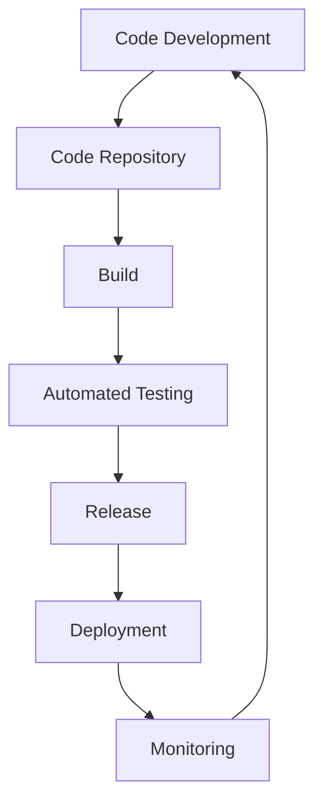

# DevOps Practices and CI/CD Pipelines

**Name:** Ilisha Agarwal  
**USN:** N825CSE148  
**Assigned Case Study:** DevOps Practices and CI/CD Pipelines

## 1. Introduction to DevOps

DevOps is a combination of Development (Dev) and Operations (Ops). It is a software engineering approach that brings developers and IT operations teams together to improve software development, testing and deployment.

DevOps focuses on automation, collaboration, continuous monitoring and faster software delivery.

## 2. Problem Analysis

An online shopping company frequently updates its application to introduce new features and fix bugs. However, manual testing and deployment cause delays and errors.

These problems can be solved by implementing DevOps practices and a CI/CD pipeline.

## 3. Continuous Integration and Continuous Delivery

**Continuous Integration (CI):** Developers regularly merge their code changes into a shared repository. Automated builds and tests are performed to identify errors early.

**Continuous Delivery (CD):** After successful testing, the application is prepared for deployment. It can be released to production with approval.

**Continuous Deployment:** Every change that passes the required tests is automatically deployed to production.

## 4. Stages of a CI/CD Pipeline

1. **Code:** Developers write and upload code to a shared repository.
2. **Build:** The source code is compiled and packaged into an application.
3. **Test:** Automated tests check the application for errors and bugs.
4. **Release:** The tested application is prepared for release.
5. **Deploy:** The application is deployed to the production environment.
6. **Monitor:** Application performance is continuously monitored.

## 5. Explanation of Build, Test and Deployment

- **Build:** Converts source code into an executable application or package.
- **Test:** Automatically checks the application to ensure that it works correctly.
- **Deployment:** Makes the tested application available to users.

## 6. Benefits of Automation

1. **Faster Delivery:** Automation reduces manual work and speeds up software releases.
2. **Improved Quality:** Automated testing helps detect bugs early.
3. **Reduced Errors:** Automated deployment reduces human mistakes and improves reliability.

## 7. CI/CD Pipeline Diagram

## 8. Conclusion

DevOps and CI/CD pipelines help software companies automate development, testing and deployment processes. By implementing these practices, the online shopping company can reduce delays, minimize errors, improve software quality and deliver new features faster to customers.
