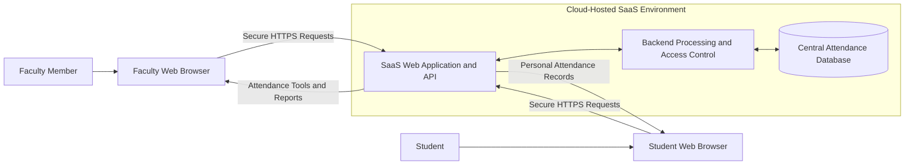

# SaaS-Based Cloud Attendance Management System

## 1. Student Details

| Field | Details |
|---|---|
| Student Name | Janani Krishnamoorthy |
| USN | NB25CSE153 |
| Subject | Software Engineering and Applications (SEA) |
| Unit | Unit 5 – Open Source Contribution |
| Assigned Case Study | Question 1 – SaaS and Cloud-Based Applications |

## 2. Introduction

Software as a Service (SaaS) is a cloud computing model in which software applications are hosted and maintained by a service provider and made available to users over the internet. Users can access these applications through a web browser without installing or maintaining the software on individual computers.

In the SaaS model, the service provider manages the application infrastructure, software updates and underlying cloud resources. Users can access the application from different devices and locations, provided they have an internet connection and the required permissions.

For a college, SaaS can be used to develop a cloud-based attendance management system that replaces manual registers and separate Excel sheets with a centralized digital platform.

## 3. Problem Analysis

The college currently maintains student attendance records using physical registers and Excel spreadsheets. This approach can create several difficulties:

- **Time-consuming processes:** Faculty members must manually record, organize and calculate attendance.
- **Data inconsistency:** Maintaining separate registers and spreadsheets may result in duplicate or inconsistent records.
- **Limited accessibility:** Records stored on individual computers or in physical registers may not be readily available to faculty working from other locations.
- **Difficult report generation:** Preparing attendance summaries and identifying students with low attendance can require additional manual effort.

Therefore, the institution needs a centralized and accessible system that simplifies attendance management while maintaining accurate and secure records.

## 4. Proposed Solution

### 4.1 SaaS-Based Attendance Management System

The proposed solution is a cloud-based attendance management application provided through the Software as a Service model.

The college can use a SaaS application hosted on cloud infrastructure. Faculty members and students can access it through a web browser using their login credentials. Attendance records are maintained in a central database rather than being stored separately on individual computers.

The application will provide different access permissions based on the user's role. Faculty members can manage attendance for their assigned classes, while students can view their own attendance records.

Since the application is hosted in the cloud, its maintenance, infrastructure management and software updates can be handled by the SaaS provider.

### 4.2 Essential Features

The proposed attendance management system should include the following features:

**1. User Authentication and Role-Based Access**

The system should provide secure login facilities for administrators, faculty members and students. Role-based access ensures that each user can access only the functions permitted for their role. For example, faculty members can record attendance, whereas students can view their own records.

**2. Student and Class Management**

Authorized faculty members or administrators should be able to manage student lists, courses and class details. This ensures that attendance is recorded for the correct students and subjects.

**3. Digital Attendance Recording**

Faculty members should be able to select a class and mark students as present or absent for a particular session. The application should validate the information and save the attendance records in the central database.

**4. Centralized Attendance Database**

All attendance records should be maintained in a centralized database. This allows authorized users to retrieve consistent and updated information without depending on multiple registers or spreadsheets.

**5. Student Attendance Dashboard**

Students should be able to log in and view their individual attendance records and attendance percentages. This helps them monitor their attendance and identify shortages.

**6. Attendance Reports**

The system should allow faculty members to generate attendance summaries based on students, subjects or selected periods. These reports can help faculty identify students with low attendance and simplify administrative work.

### 4.3 System Architecture

The following diagram illustrates the basic architecture of the proposed SaaS attendance management system.

**Diagram Explanation:**

1. Faculty members and students access the system through their respective web browsers.
2. Requests are sent securely to the cloud-hosted SaaS application using HTTPS.
3. The backend processes requests, verifies user permissions and performs the required operations.
4. The central attendance database stores and retrieves attendance information.
5. Faculty members receive attendance management tools and reports, while students can view their individual attendance records.

This architecture provides a centralized way to manage attendance while allowing authorized users to access the system from different locations.

## 5. Benefits and Challenges

### 5.1 Benefits of Cloud-Based Applications

**1. Accessibility from Anywhere**

Faculty members can access attendance records from any location using an internet-connected device. This reduces dependence on a particular college computer or physical register. Students can also check their attendance without having to approach faculty members for every update.

**2. Centralized and Consistent Data**

Attendance records are stored in one central database. Authorized users can access updated information rather than maintaining multiple independent copies of attendance sheets. This improves consistency and simplifies record management.

**3. Improved Efficiency and Transparency**

Digital attendance recording reduces repetitive manual work. Faculty members can generate attendance reports more easily, while students can monitor their attendance through their own dashboards. This saves administrative effort and improves communication about attendance records.

### 5.2 Possible Challenges

**1. Dependence on Internet Connectivity**

Since the application is cloud-based, users need a reliable internet connection to access it. Network failures or service interruptions may temporarily prevent faculty members from recording or viewing attendance.

*Possible measure:* The institution should ensure reliable network access and establish a procedure for temporarily recording attendance when the service is unavailable, followed by updating the system when connectivity is restored.

**2. Data Privacy and Security**

The system stores student-related academic information. Unauthorized access, weak passwords or security vulnerabilities could expose confidential attendance records.

*Possible measure:* The application should use strong authentication, role-based access control, secure communication, appropriate data encryption and regular backups. Access should be limited to authorized users.

## 6. Conclusion

A SaaS-based cloud attendance management system can provide an efficient alternative to maintaining student attendance through manual registers and separate Excel sheets. By offering digital attendance recording, centralized storage, student dashboards and report generation, the system can simplify the work of faculty members and improve access to attendance information for students.

Although internet connectivity and data security are important challenges, they can be addressed through appropriate infrastructure and security practices. Overall, adopting the SaaS model can help the college establish a more accessible, consistent and manageable attendance system.
