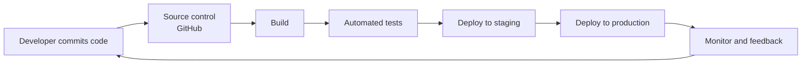

# DevOps Practices and CI/CD Pipelines: Online Shopping Application

## Student Details
- **Name:** Janavi Ashok Kamepalli
- **USN:** NB25CSE154  
- **Assigned Case Study:** Question 3 – DevOps Practices and CI/CD Pipelines

## Introduction
**DevOps** is a set of practices that brings development (Dev) and operations (Ops) teams together so software can be built, tested and released faster and more reliably. It relies on collaboration, automation, monitoring and continuous feedback.

- **Continuous Integration (CI):** Developers merge code into a shared repository frequently. Each merge automatically triggers a build and tests so errors are found early.
- **Continuous Delivery (CD):** Every tested change is automatically prepared for release, and deployment to production needs a manual approval.
- **Continuous Deployment:** Every change that passes all tests is deployed to production automatically, with no manual step.

## Problem Analysis
A company develops an online shopping application and updates it often with new features and bug fixes. Manual testing and deployment cause:
- Delays in releasing new features.
- Human errors during deployment.
- Bugs reaching customers because testing is incomplete.
- Slow fixes when something fails in production.

## Proposed Solution
The company can apply DevOps practices and build an automated CI/CD pipeline. Every code change moves through the pipeline automatically, from commit to production.

### CI/CD Pipeline Diagram

### Pipeline Stages
1. **Source:** The developer pushes code to a Git repository, which triggers the pipeline.
2. **Build:** The pipeline compiles the code, installs dependencies and creates a deployable package such as a Docker image. If the build fails, developers are alerted immediately.
3. **Test:** Automated unit, integration and functional tests run. Failed tests stop the pipeline so faulty code never reaches customers.
4. **Deploy:** The tested package is released first to a staging environment and then to production, using automation tools such as Jenkins, GitHub Actions or GitLab CI.
5. **Monitor:** Tools track performance and errors in production, and the findings feed back to the developers.

## Benefits and Challenges

### Three Benefits of Automation
1. **Faster releases:** New features and bug fixes reach customers in hours instead of days.
2. **Fewer errors:** Automated builds, tests and deployments remove manual mistakes and catch bugs early.
3. **Better quality and teamwork:** Frequent small releases are easier to test and fix, and developers and operations share responsibility.

### Challenges
- Setting up the pipeline needs initial time, skills and tools.
- Automated tests must be written and maintained.

## Conclusion
Applying DevOps and a CI/CD pipeline lets the online shopping company replace slow, error-prone manual work with a reliable automated process. Code is built, tested and deployed automatically, which gives faster releases, better quality and happier customers.
