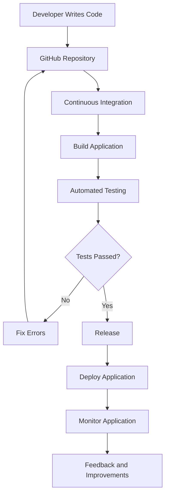

# DevOps Practices and CI/CD Pipelines

**Name:** K Neeraj  
**USN:** NB25CSE168  
**Section:** C  
**Subject:** Software Engineering  
**Case Study:** DevOps and CI/CD Pipeline for an Online Shopping Application

## 1. Introduction

DevOps is a software engineering approach that combines Development (Dev) and Operations (Ops) to improve software development, testing and deployment.

It encourages collaboration between development and operations teams through automation, continuous integration and continuous delivery.

For an online shopping application, DevOps practices help developers introduce new features, fix bugs and deliver software updates efficiently.

## 2. Problem Analysis

A software company develops an online shopping application. Developers frequently update the application to introduce new features and fix existing bugs.

However, manual testing and deployment create several problems:

- Software updates take more time.
- Manual testing may result in human errors.
- Deployment failures can affect application availability.
- Developers and operations teams may face communication problems.

To solve these issues, the company can implement DevOps practices and a CI/CD pipeline to automate software development and deployment.

## 3. Meaning of Continuous Integration and Continuous Delivery

### Continuous Integration (CI)

Continuous Integration is the practice of frequently combining code changes from different developers into a shared repository.

Whenever developers submit code, automated processes build and test the application to identify errors early.

### Continuous Delivery (CD)

Continuous Delivery is the process of preparing tested software for release through an automated pipeline.

It ensures that the application is always ready for deployment. Production deployment may require manual approval.

### Continuous Deployment

Continuous Deployment automatically releases successfully tested changes to the production environment without requiring manual approval for each release.

## 4. CI/CD Pipeline Stages

The major stages of a CI/CD pipeline are:

### 1. Plan

Developers identify requirements, plan new features and organize development tasks.

### 2. Code

Developers write application code and upload their changes to a shared version control repository such as GitHub.

### 3. Build

The build stage automatically compiles and packages the application to prepare it for testing.

### 4. Test

Automated tests are performed to identify bugs and verify that new changes do not affect existing features.

### 5. Release

After successful testing, the application package is prepared for release.

### 6. Deploy

The application is deployed to a staging or production environment.

### 7. Monitor

The application is continuously monitored to identify performance problems, errors and unexpected failures.

## 5. Explanation of Build, Test and Deployment

**Build:** The source code is converted into an executable application or deployable package.

**Test:** Automated testing checks application functionality, security and performance to ensure quality.

**Deployment:** The tested application is transferred to the target server or cloud environment so that customers can use the updated shopping application.

## 6. CI/CD Pipeline Diagram

## 7. Benefits of DevOps and CI/CD Automation

1. Faster software development and delivery.
2. Early identification and correction of errors.
3. Reduced manual work and human errors.
4. Improved collaboration between development and operations teams.
5. More reliable software updates.
6. Better application quality and customer satisfaction.

## 8. Challenges

1. **Initial Setup:** Configuring automation tools and pipelines requires time and technical knowledge.
2. **Security:** Sensitive information such as passwords and API keys must be protected.
3. **Team Training:** Developers and operations teams need proper training to understand DevOps tools and practices.

## 9. Conclusion

DevOps practices and CI/CD pipelines help organizations automate software development, testing and deployment.

For the online shopping application, implementing a CI/CD pipeline reduces manual effort, improves software quality and enables faster delivery of new features and bug fixes.

Therefore, DevOps provides an efficient and reliable approach to managing modern software development projects.
