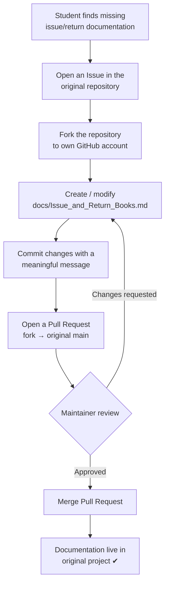

# Open-Source Software Engineering – Contributing Documentation to a Library Management System

## 1. Title and Student Details

| Field | Details |
|-------|---------|
| **Name** | Akanksha Khandave |
| **USN** | NB25CSE169 |
| **Assigned Case Study** | Question 4 – Open-Source Software Engineering |
| **Topic** | Improving the documentation of an open-source Library Management System through the GitHub fork → commit → Pull Request workflow |

---

## 2. Introduction

### 2.1 What is Open-Source Software Engineering?

**Open-source software (OSS)** is software whose source code is publicly available under a licence (such as MIT, Apache 2.0 or GPL) that allows anyone to view, use, modify and redistribute it.

**Open-source software engineering** is the practice of developing such software collaboratively and in public. Instead of a single closed team, contributors from anywhere in the world work together using:

- **Version control** (Git) to track every change
- **Hosting platforms** (GitHub, GitLab) to share code and manage work
- **Issues** to report bugs and suggest improvements
- **Forks and Pull Requests (PRs)** to propose changes safely
- **Code / documentation review** by maintainers before changes are accepted

Well-known examples include Linux, Python, Git itself, VS Code and Mozilla Firefox.

### 2.2 Importance of Contributing to Open-Source Projects

| For the contributor (student) | For the project and community |
|------------------------------|-------------------------------|
| Real-world experience with Git, GitHub and teamwork | Bugs are found and fixed faster ("many eyes") |
| Builds a public portfolio visible to recruiters | Better documentation makes the project easier to adopt |
| Learns code review, coding standards and communication | New contributors bring fresh ideas and features |
| Networking with experienced developers | The project stays alive and maintained over time |

> Contributions are **not only code**. Documentation, tutorials, translations, bug reports and tests are equally valuable – and documentation is often the best first contribution for a beginner.

---

## 3. Problem Analysis

**Case:** A group of developers maintains an open-source **Library Management System (LMS)** on GitHub. A student using the project notices that:

1. There is **no documentation** explaining how a user **issues** a book.
2. There is **no documentation** explaining how a user **returns** a book (including due dates and fines).
3. New users and new contributors must read the source code to understand these core features.

**Impact of the problem:**

- Librarians and students cannot use the system confidently.
- More questions/issues are raised by confused users, wasting maintainers' time.
- New contributors find it hard to get started, so the project grows slowly.

**Root cause:** Documentation was not treated as part of the development process – features were added, but user-facing guides were never written.

---

## 4. Proposed Solution

The student will fix the problem by **contributing a documentation file** to the project using the standard open-source GitHub workflow. The student does **not** need write access to the original repository – the fork-and-pull-request model lets anyone contribute safely.

### 4.1 Step 1 – (Optional but recommended) Open an Issue

1. Go to the original repository → **Issues** → **New issue**.
2. Title: `Docs: Add guide for issuing and returning books`.
3. Describe what is missing and offer to write it.

This tells the maintainers what you plan to do and avoids duplicate work.

### 4.2 Step 2 – Fork the Repository

1. Sign in to GitHub with your **own** account.
2. Open the original repository, e.g. `https://github.com/<maintainer>/Library-Management-System`.
3. Click **Fork** (top-right).
4. Select **your account** as the owner, keep the repository name unchanged.
5. Tick **Copy the main branch only** and click **Create fork**.

You now have `your-username/Library-Management-System`, marked *"forked from &lt;maintainer&gt;/Library-Management-System"*. Changes here do **not** affect the original project.

### 4.3 Step 3 – Create or Modify the Documentation File

In **your fork**:

1. Open the `docs` folder (or the root folder).
2. Click **Add file → Create new file** (or open `README.md` and click the ✏️ edit icon to modify it).
3. Filename: `docs/Issue_and_Return_Books.md`
4. Write the documentation. Example content:

```markdown
# How to Issue and Return Books

## Issuing a Book
1. Log in as a Librarian.
2. Go to **Books → Issue Book**.
3. Enter the Member ID (e.g. student USN) and the Book ID / ISBN.
4. The system checks:
   - the book is available (copies > 0)
   - the member has not exceeded the borrowing limit (e.g. 3 books)
   - the member has no unpaid fines
5. Click **Issue**. The due date (14 days from today) is shown and
   the available copy count is reduced by 1.

## Returning a Book
1. Go to **Books → Return Book**.
2. Enter the Book ID or scan the barcode.
3. The system shows the issue date and due date.
4. If returned late, a fine is calculated
   (e.g. Rs. 2 per day after the due date).
5. Click **Return**. The available copy count increases by 1 and
   the transaction is saved in the member's history.

## Common Errors
| Message | Meaning | Fix |
|---------|---------|-----|
| Book not available | All copies are issued | Reserve the book |
| Limit exceeded | Member already has max books | Return a book first |
| Pending fine | Member has an unpaid fine | Pay the fine at the desk |
```

5. Also add a link to the new guide in the main `README.md` so users can find it.

**Good documentation practices followed:** clear headings, numbered steps, examples, an error table, simple language, and Markdown formatting that renders nicely on GitHub.

### 4.4 Step 4 – Commit the Changes

1. Scroll down to **Commit changes**.
2. Write a clear, meaningful commit message, for example:
   - `docs: add guide for issuing and returning books`
3. Optional extended description: `Explains issue/return steps, fine rules and common errors. Closes #12.`
4. Choose **Commit directly to the main branch** of your fork (or create a new branch such as `docs/issue-return-guide`, which is the cleaner practice).
5. Click **Commit changes**.

### 4.5 Step 5 – Submit a Pull Request

1. Return to the main page of **your fork**.
2. Click **Contribute → Open pull request**.
3. Verify the settings:

| Setting | Expected value |
|---------|----------------|
| Base repository | `<maintainer>/Library-Management-System` |
| Base branch | `main` |
| Head repository | `your-username/Library-Management-System` |
| Compare branch | `main` (or `docs/issue-return-guide`) |

4. Title: `Docs: Add guide for issuing and returning books`
5. Description: what was added, why, and `Closes #12` to link the issue.
6. Click **Create pull request**.

If **Contribute** is not shown, use **Pull requests → New pull request → compare across forks** and select the same repositories and branches.

### 4.6 Step 6 – Review and Merge

1. Maintainers open the PR → **Files changed** to review the documentation.
2. They may leave comments asking for changes; the student updates the file in the fork, and the PR updates automatically.
3. Once approved, a maintainer clicks **Merge pull request → Confirm merge**.
4. The new guide now appears in the original repository, and the student is listed as a **contributor**.

### 4.7 Equivalent Git Command-Line Workflow

```bash
# 1. Clone your fork
git clone https://github.com/your-username/Library-Management-System.git
cd Library-Management-System

# 2. Link the original repo (to stay up to date)
git remote add upstream https://github.com/<maintainer>/Library-Management-System.git

# 3. Create a branch for the change
git checkout -b docs/issue-return-guide

# 4. Create/modify the documentation file, then stage and commit
git add docs/Issue_and_Return_Books.md README.md
git commit -m "docs: add guide for issuing and returning books"

# 5. Push to your fork
git push origin docs/issue-return-guide

# 6. Open a Pull Request on GitHub from this branch to upstream main
```

### 4.8 GitHub Contribution Workflow Diagram



Text version of the same workflow:

```
 ┌──────────────────────┐
 │ Original Repository  │  maintainer/Library-Management-System
 └──────────┬───────────┘
            │ 1. Fork
            ▼
 ┌──────────────────────┐
 │ Student's Fork       │  student/Library-Management-System
 └──────────┬───────────┘
            │ 2. Create / edit  docs/Issue_and_Return_Books.md
            │ 3. Commit  "docs: add guide for issuing and returning books"
            ▼
 ┌──────────────────────┐
 │   Pull Request       │  student:main  ──►  maintainer:main
 └──────────┬───────────┘
            │ 4. Review (comments / changes requested → back to step 2)
            ▼
 ┌──────────────────────┐
 │   Merge              │  Docs now part of the original project
 └──────────────────────┘
```

---

## 5. Benefits and Challenges

### 5.1 Benefits of Collaborative Software Development

1. **Better quality** – every change is reviewed by others before it is merged, catching mistakes early.
2. **Faster development** – many contributors work in parallel on different features, bugs and docs.
3. **Shared knowledge** – good documentation (like this guide) helps users and new contributors understand the system without reading the code.
4. **Transparency and traceability** – Git history, issues and PRs record *who* changed *what* and *why*.
5. **Safe experimentation** – forks and branches let contributors try changes without breaking the original project.
6. **Community and learning** – students gain real experience, and the project gains long-term contributors.

### 5.2 Expected Results for the Library Management System

- Users can issue and return books correctly without help.
- Fewer "how do I…?" issues for maintainers to answer.
- New contributors onboard faster, so the project grows.

### 5.3 Challenges / Limitations

| Challenge | How to handle it |
|-----------|------------------|
| Fork becomes out of date with the original repo | Use **Sync fork** on GitHub or `git fetch upstream` + merge |
| Merge conflicts when others edit the same file | Pull latest changes before editing; resolve conflicts carefully |
| PR may wait a long time or be rejected | Discuss in an Issue first; follow `CONTRIBUTING.md` guidelines |
| Documentation can become outdated as features change | Update docs in the same PR that changes a feature |
| Understanding project conventions as a newcomer | Read README, CONTRIBUTING and Code of Conduct before contributing |

---

## 6. Conclusion

The Library Management System lacked documentation for its most important features – issuing and returning books. Using **open-source software engineering** practices, the student solved this without needing direct access to the project: they **forked** the repository, **created a documentation file** with clear steps, examples and error messages, **committed** it with a meaningful message, and **submitted a Pull Request** for the maintainers to review and merge.

This fork → commit → Pull Request workflow is the foundation of open-source collaboration. It keeps the original project safe, ensures every change is reviewed, and allows anyone – including students – to improve real software. Even a documentation-only contribution makes the project easier to use, easier to maintain and more welcoming to future contributors.
