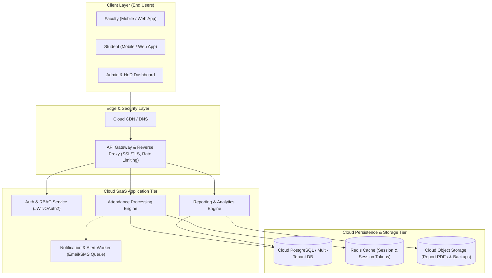

# SaaS and Cloud-Based Attendance Management System

## Student Details
- **Student Name:** Koustav Dey
- **USN:** NB25CSE175
- **Course:** Software Engineering & Architecture (SEA)
- **Activity:** Unit 5 – Open Source Contribution Project (LA-2)
- **Assigned Case Study:** Question 1 – SaaS and Cloud-Based Applications

---

## 1. Introduction to SaaS
**Software as a Service (SaaS)** is a cloud computing delivery model in which software applications are centrally hosted on cloud infrastructure and delivered to end-users over the Internet, typically accessed via web browsers or mobile clients. 

Unlike traditional on-premise software—which requires local installation, manual updates, and on-site hardware maintenance—SaaS operates on a managed, multi-tenant architectural foundation:
- **Centralized Management:** Application updates, security patches, performance scaling, and database backups are managed entirely by the service provider or cloud administrator.
- **On-Demand Elasticity:** Compute and storage scale dynamically according to workload demands without requiring physical server provisioning.
- **Cost Efficiency:** Eliminates heavy upfront capital expenditure (CapEx) for localized data centers, transitioning to predictable operational expenditures (OpEx).
- **Ubiquitous Access:** Authorized users can access services securely across diverse operating systems and mobile devices anytime, anywhere.

---

## 2. Problem Analysis
The college currently relies on manual paper attendance registers and decentralized Microsoft Excel spreadsheets to maintain student attendance records. This legacy approach presents several critical software engineering and operational vulnerabilities:

1. **High Inefficiency & Human Error:** Faculty spend substantial classroom instructional time manually taking roll calls and entering tick marks in registers, followed by repetitive, redundant entry into Excel sheets. This introduces transcription errors and formula mismatches.
2. **Data Fragmentation & Lack of a Single Source of Truth:** Multiple versions of Excel spreadsheets exist across different faculty laptops and departmental drives. Consolidating monthly or semester attendance requires hours of manual cross-referencing.
3. **Physical Damage and Loss Risks:** Paper registers are susceptible to wear, physical loss, tampering, or damage from water/fire incidents, with no redundant backup mechanism.
4. **Delayed Deficiency Detection:** Students and academic advisors often discover attendance shortages only at the end of the semester when exam hall tickets are processed, leaving no window for timely intervention.
5. **No Real-Time Auditing or Accessibility:** Remote access is impossible; faculty cannot check or record attendance away from campus, and students cannot track their own eligibility in real time.

---

## 3. Proposed Solution: Cloud-Based SaaS Attendance System
The proposed solution transitions the college to a centralized, cloud-native **SaaS Attendance Management System**. The application is deployed in a multi-tenant cloud environment where administrative staff, faculty, students, and department heads interact through role-based interfaces with real-time database synchronization.

### Essential Features (Minimum 4)
1. **Role-Based Access Control (RBAC) & Secure Authentication:**
   - Granular access permissions for Administrators, Heads of Departments (HoDs), Course Instructors, and Students.
   - Integration with Institutional Single Sign-On (SSO) and Multi-Factor Authentication (MFA) ensuring secure, compliant access.
2. **Real-Time Attendance Marking & Session Tracking:**
   - Rapid attendance recording interface organized by semester, section, and elective courses.
   - Support for multiple recording mechanisms including quick one-click student rosters, dynamic time-limited session tokens, or QR verification.
3. **Automated Notification & Attendance Shortage Alert Engine:**
   - Automated event-driven background service that continuously tracks individual subject attendance percentages against the mandatory 75% regulatory requirement.
   - Dispatches automated SMS, push notifications, and emails to students and guardians whenever attendance drops into the warning zone (< 85% and < 75%).
4. **Dynamic Analytics, Compliance Audits & One-Click Report Generation:**
   - Real-time departmental dashboards displaying class attendance trends, average student engagement, and anomaly flags.
   - One-click export of official university compliance reports in PDF and XLSX formats for examination eligibility verification.

---

## 4. System Architecture Diagram

---

## 5. Benefits and Challenges

### Benefits of Cloud-Based SaaS Applications
1. **Universal Accessibility & Remote Device Independence:**
   Faculty members can access, update, and review attendance records from anywhere—whether on campus, working from home, or during off-campus duties—using any web-enabled device (smartphone, tablet, laptop) without needing local VPN software or manual file transfers.
2. **Scalability, Zero Local Maintenance & High Reliability:**
   The cloud infrastructure automatically scales during peak concurrent load periods (e.g., synchronous end-of-class marking across campus). Automatic cloud backups, geo-redundancy, and managed software patching eliminate local server hardware failures and dedicated IT server maintenance.
3. **Data Integrity & Single Source of Truth:**
   All records are centralized in an ACID-compliant cloud relational database. Changes reflect instantly for faculty, heads of department, and students, eliminating duplicate, unsynchronized Excel files and ensuring accurate academic compliance.

### Challenges and Mitigations
1. **Network Connectivity Dependency:**
   - *Challenge:* If campus Wi-Fi or cellular service experiences downtime in basement labs or remote rooms, cloud-only systems can prevent immediate attendance entry.
   - *Mitigation:* Implement Progressive Web App (PWA) architecture with Service Workers and IndexedDB local caching. Attendance marked offline is queued locally and automatically synchronized with optimistic concurrency control when connectivity resumes.
2. **Data Security, Privacy, and Tenant Isolation:**
   - *Challenge:* Hosting sensitive student records, personal identification, and attendance trends on public cloud infrastructure raises concerns regarding data leakage and regulatory compliance.
   - *Mitigation:* Enforce end-to-end data encryption (TLS 1.3 in transit and AES-256 at rest), strict row-level security (RLS) policies for multi-tenancy, and regular automated vulnerability assessments adhering to privacy standards.

---

## 6. Conclusion
Transitioning from manual registers and fragmented Excel sheets to a Software as a Service (SaaS) attendance management system resolves longstanding administrative bottlenecks for educational institutions. By leveraging a centralized, multi-tenant cloud architecture with role-based access, automated notifications, and real-time analytics, the institution gains operational transparency, protects data integrity, and empowers faculty and students with accessible, reliable academic tracking.
