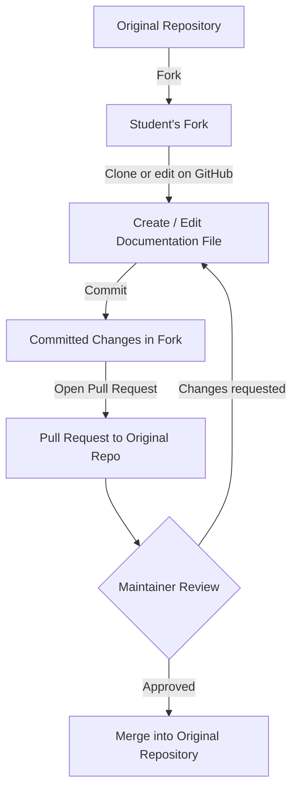

# Open Source Software Development

**Name:** Sreekar
**USN:** NB25CSE180
**Assigned Case Study:** Question 4 – Open-Source Software Engineering

---

## 1. Introduction

Open source software development involves developing software in which the source code is public. It can be viewed, used, modified and distributed freely, usually under a particular license (e.g. MIT, Apache 2.0, GPL). These projects tend to be hosted on GitHub, meaning that multiple developers from different organisations can contribute to a single project.

There are many ways to contribute to open source projects. These include contributing documentation, filing issues, testing, translating and designing.

### Importance of contributions

- **Improves the software:** Better documentation means that more people can use the software.
- **Improves knowledge:** Using Git, GitHub, code reviews and working in teams builds knowledge.
- **Builds a public portfolio:** Accepted contributions provide evidence of work to show potential employers.
- **Benefits the wider community:** The majority of software relies on open source software in some way.
- **Gives real-world experience:** Contributors work within real software and with maintainers.

---

## 2. Problem Analysis

A group of developers has created an open source Library Management System (LMS) on GitHub. However, there is no documentation to help users understand how to issue and return books.

### Implications of this problem

- New users cannot easily perform very common library actions.
- Maintainers waste time repeatedly answering the same questions.
- The project is harder for new contributors to understand, which could lead them to give up on it.

### Opportunity for contribution

Adding documentation is a good opportunity for contribution. It does not require major changes to the code and is therefore a low-risk contribution.

---

## 3. Proposed Solution

To improve this project, documentation can be added by following the fork and pull request process.

### Step 1: Fork

1. Go to the Library Management System repository.
2. Click **Fork**.
3. Select your own account as the owner and leave the repository name the same.
4. Click **Create fork**.

You now have a copy of the repository in your account. Changes cannot be made directly to the original repository, so it is safe to make changes in your forked version.

### Step 2: Add documentation

Click **Add file → Create new file** and name the file `docs/Issue_and_Return_Books.md`. Alternatively, if there is a README file, edit that instead.

Information can then be added to this file. For example:

```markdown
# Issuing and Returning Books

## Issuing a Book
1. Log in as a librarian or registered member.
2. Search for the book by title, author or ISBN.
3. Check that the book status is "Available".
4. Click "Issue Book" and select the member.
5. The system records the issue date and sets the due date.

## Returning a Book
1. Open the "Return Book" page.
2. Enter the member ID or book ID.
3. Confirm the book details.
4. Click "Return". The system updates the book status to "Available".
5. If the return is after the due date, a fine is calculated.
```

### Step 3: Commit changes

1. Click **Commit changes**.
2. Write a clear message. In this case: `Added documentation for issuing and returning books`.
3. Commit to the `main` branch of your forked repository.

### Step 4: Pull request

1. Go to the main page of your forked repository.
2. Click **Contribute → Open pull request**.
3. Make sure you are using the correct repositories. The base should be the original repository (`main`) and the head should be your forked repository (`main`).
4. Write a title for your PR, for example: `Add documentation for issuing and returning books`.
5. Write a brief description, then click **Create pull request**.

### Step 5: Review and accept

Maintainers will review your pull request in the **Files changed** tab. They may add comments or ask for changes. Once they approve the change, they can click **Merge pull request**. This adds the documentation to the original repository.

### GitHub Contribution Process



---

## 4. Advantages and Issues

### Advantages

- **Improved quality:** With many people reviewing changes, mistakes are less likely to occur.
- **Speed:** Work can be distributed to multiple people in different places, improving the speed of development.
- **Transparency:** All changes can be seen, along with who made them, why, and their history.
- **Knowledge sharing:** Developers can learn from each other's code and feedback.
- **Cost efficient:** The work is done for free by members of the community.

### Issues

- **Learning curve:** People making their first contribution must learn Git, forking, branching and pull requests.
- **Long waits in review:** Maintainers are often volunteers, so pull requests may be left for days or weeks.
- **Merge conflicts:** If changes have been made to the original repository, the contribution may need to be updated.
- **Complying with guidelines:** Each project has its own contribution guidelines (`CONTRIBUTING.md`), and these must be followed.

---

## 5. Conclusion

By adding documentation for issuing and returning books, we improve the usefulness of the LMS. To make this contribution, a student would fork the repository, add documentation, commit the changes and open a pull request to be reviewed. This demonstrates the benefits of open source software development by allowing people to contribute to real projects. Peer review also improves software quality, and practical skills in collaborative development can be gained.
