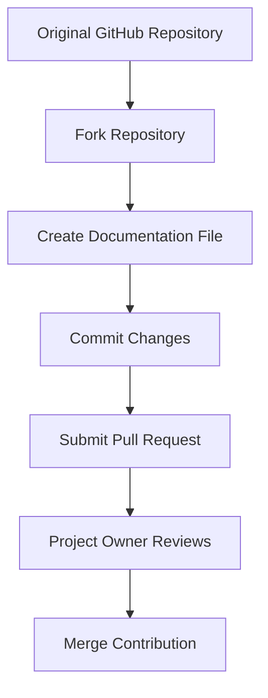

# Open-Source Software Engineering

**Name:** K Sreemanth  
**USN:** NB25CSE181  
**Subject:** Software Engineering  
**Case Study:** Open-Source Software Contribution

## 1. Introduction

Open-source software engineering is a process of developing software where the source code is publicly available. Developers can access, study, modify and contribute to the software.

GitHub is a popular platform used for hosting open-source projects and collaborating with other developers.

## 2. Problem Analysis

A group of developers is working on an open-source Library Management System hosted on GitHub. A student identifies that the project does not have proper documentation explaining how users can issue and return books.

Without proper documentation, users may find it difficult to understand the system and use its features correctly.

Therefore, the student decides to improve the documentation by contributing to the project.

## 3. Proposed Solution

The student can improve the project documentation by following the GitHub open-source contribution process.

### Step 1: Fork the Repository

The student visits the original GitHub repository and clicks the Fork option. This creates a personal copy of the project.

### Step 2: Create or Modify Documentation

The student opens the copied repository and creates a Markdown file explaining the steps to issue and return books in the Library Management System.

### Step 3: Commit Changes

After writing the documentation, the student saves the changes using a commit message. A commit records the modifications made to the project.

### Step 4: Submit a Pull Request

The student creates a Pull Request to propose adding the documentation to the original repository.

### Step 5: Review and Merge

The project owner reviews the submitted changes. If the contribution is correct, the owner merges the Pull Request into the original repository.

## 4. GitHub Contribution Workflow

## 5. Benefits of Open-Source Contribution

1. Improves software quality and documentation.
2. Encourages teamwork and collaboration.
3. Helps students gain practical GitHub experience.
4. Allows developers to share knowledge.
5. Improves technical and problem-solving skills.

## 6. Challenges

1. Understanding an existing project may take time.
2. Merge conflicts can occur when multiple developers modify the same files.
3. Contributions may be rejected if they do not follow project guidelines.

## 7. Conclusion

Open-source software engineering encourages developers to work together and improve software projects. By using GitHub features such as Fork, Commit and Pull Request, students can contribute to real-world projects.

Improving the Library Management System documentation makes the software easier to understand and use. This activity also helps students develop practical collaboration and software engineering skills.
