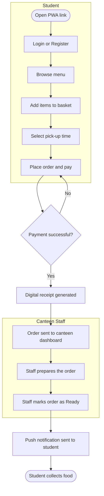

# Online Canteen Food-Ordering System

**Name:** Vyshnav Madineni
**USN:** NB25CSE192
**Assigned Case Study:** Question 2 – Mobile and Web Applications Engineering

---

## 1. Introduction

As there are a large number of people in the canteen during break times, specifically at lunchtimes, this has caused a large queue for students. Furthermore, staff in the canteen are unable to efficiently take orders from multiple students. In order to improve this situation, an online ordering system can be implemented.

There are three options for an application to be developed:

- **Mobile applications** allow access to features specific to mobile phones such as cameras, location and push notifications. They must be downloaded from an app store.
- **Web applications** can be accessed by clicking a link in a browser. They do not need to be downloaded and can therefore be accessed by nearly any device.
- **Progressive web applications (PWAs)** have features similar to mobile applications. These can be saved to your home screen, have partial offline functionality, and have push notifications.

---

## 2. Problem Analysis

Currently, students have to collect their food in person. This means that they may be left waiting in long lines. Orders may be missed and students may be unsure if their food is ready.

To improve this, a system should allow students to search the menu, place an order, pay and be notified when their food is ready. As many students may be using this system (potentially hundreds), and on different phones, the system must be easily accessible, efficient during busy times, and cheap to develop and maintain.

---

## 3. Proposed Solution

### 3.1 Comparison of Approaches

| Criteria | Native Mobile App | Web App | PWA |
| --- | --- | --- | --- |
| Installation | Must be downloaded from the app store | Not required | Can optionally be added to home screen |
| Code base | Separate code for Android and iOS | One code base | One code base |
| Offline functionality | Fully functional | Not available | Partially functional (cached menu) |
| Updates | May require updates to the application | Instant updates | Instant updates |

### 3.2 Selected Approach: Progressive Web Application

A Progressive Web Application is the best option for the canteen ordering system. Firstly, only one code base is needed, meaning that students with Android phones and iPhones can use it, and staff in the canteen with computers can use it.

As it is a Progressive Web Application, students don't have to download the application nor take up any storage space on their phone. They can simply click on the link and start placing orders. Users will also be sent push notifications to let them know when their food is ready. If the menu needs to be updated, prices changed or bugs fixed, this can be done instantly. The menu can be cached, meaning that it loads quickly and can still partially function when the internet within the campus is poor.

Although a native application would give more device functionality, this is not necessary for the purpose of placing food orders. It would also be more expensive to develop for Android and iOS. A standard web application could be easily developed, however it would not provide the same features as the PWA. For example, notifications would be less reliable.

### 3.3 Major Functionalities

1. **Menu:** Display foods, prices, categories and availability.
2. **Ordering:** Items can be added to the basket, a pick-up time selected and the order confirmed.
3. **Payment:** Payment can be made via UPI, cards or wallets. A digital receipt is generated.
4. **Order status:** Order status can be edited in a dashboard by canteen staff. Students will be notified when their order is ready.

### 3.4 Application Workflow

---

## 4. Benefits and Challenges

### Benefits

- **For users:** Less time spent queuing. Food can be collected when it is ready.
- **For canteen staff:** Orders can be seen coming in real time, meaning they can prepare orders more efficiently.
- **For the college:** Useful data can be gained on popular foods and busy ordering times.

### Development Challenges

1. **Security and payment integration:** Payments must be securely integrated with a payment gateway. Data about users and payments must be kept secure.
2. **Handling high volumes of requests:** During lunch times, a large number of students may be ordering, so the backend must be able to handle this without lagging or becoming inaccessible.
3. **Compatibility with devices and notifications:** The PWA must be compatible with different browsers and screen sizes. Support for push notifications may vary depending on the device. On iPhones, users may need to save the PWA to their home screen in order for push notifications to work.

---

## 5. Conclusion

Overall, implementing an online food ordering system within the canteen can help reduce queues, reduce errors in order taking, and provide a more convenient way for students to order food.

From these options, it is most appropriate to implement a Progressive Web Application as it is easily accessible, cheap to maintain and provides useful features such as notifications and partial offline functionality. Secure payment methods and a backend that can handle busy lunch times mean that this system can improve the experience for students and canteen staff.
