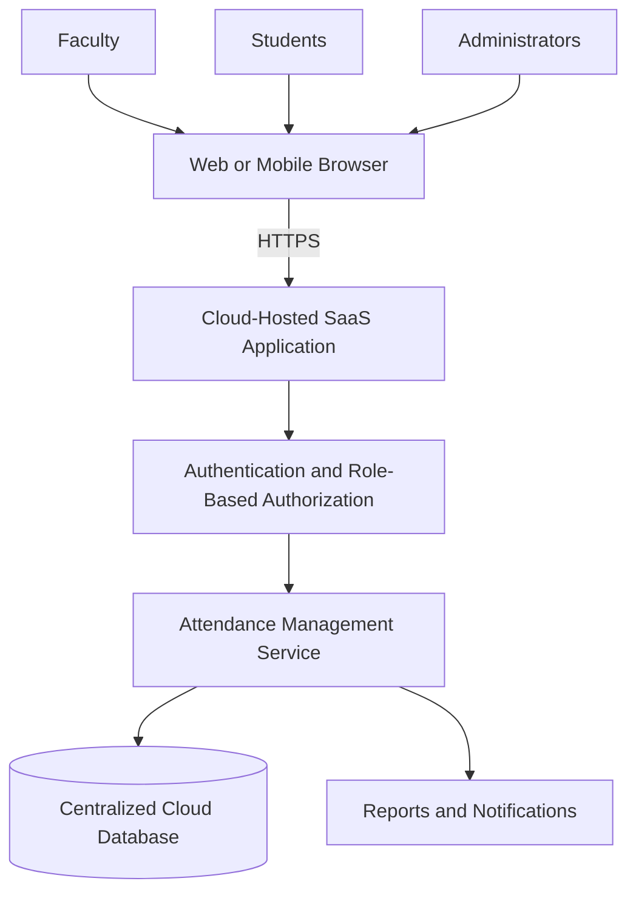

# SaaS-Based Cloud Attendance Management System

**Student Name:** Manish Kumar Pradhan  
**USN:** NB25CSE202  
**Case Study:** Question 1 — SaaS and Cloud-Based Applications  
**Activity:** Unit 5 — Open-Source Contribution Project

## 1. Introduction to SaaS

**Software as a Service (SaaS)** is a cloud-based software delivery model in which an application is hosted and maintained by a service provider and accessed by authorized users over the internet, typically through a web browser. Rather than installing and maintaining separate software on every college computer, the institution can use a centrally managed attendance application. SaaS may be offered through a subscription or institutional license; its defining feature is delivery of software as an ongoing service, not a particular payment method.

## 2. Problem Analysis

The college currently manages attendance using **paper registers and Excel sheets**. This creates several difficulties:

- **Manual effort:** Faculty spend time recording attendance and calculating totals.
- **Inconsistent records:** Duplicate spreadsheets, entry mistakes, and misplaced registers can affect accuracy.
- **Limited access:** Faculty may not have the latest records when away from campus, while students may receive updates late.
- **Slow reporting:** Preparing subject-wise attendance summaries and identifying students with low attendance takes additional effort.

The proposed system must make attendance easier to record and access while ensuring that only authorized people can view or modify records.

## 3. Proposed SaaS Attendance Management System

The college can adopt a **cloud-hosted attendance management application** with three user roles:

- **Faculty:** Record attendance for assigned classes, view class reports, and request or make authorized corrections.
- **Students:** View their own subject-wise attendance and notifications; they cannot edit attendance records.
- **Administrators:** Manage authorized users, subjects, class assignments, and institutional reports.

### Essential Features

1. **Secure login and role-based access:** Each user signs in with an individual account; permissions depend on their role and assigned classes.
2. **Digital attendance marking:** Faculty record present/absent status for a selected class, subject, and date. Corrections are controlled and logged.
3. **Automatic attendance calculation:** The system calculates attendance percentages from recorded classes. For example, attending **18 out of 20** classes gives **(18 ÷ 20) × 100 = 90%** attendance.
4. **Student self-service dashboard:** Students can see their own subject-wise percentages, class history, and recent updates.
5. **Reports and exports:** Authorized faculty and administrators can generate subject-wise or class-wise summaries instead of combining spreadsheets manually.
6. **Low-attendance notifications:** The application can alert students when their percentage falls below a threshold configured by the institution.

### Simple Cloud Architecture Diagram

**How it works:** A user opens the application in a browser over a secure HTTPS connection. After login, the backend checks the user's role and permissions. Faculty can submit attendance for their assigned classes; the service stores authorized changes in the centralized database. Students can retrieve only their own records, while reports and notifications use the same updated data. The provider maintains the hosted application, database infrastructure, and software updates.

## 4. Three Benefits of Cloud-Based Access

1. **Anywhere access:** Authorized faculty can record or check attendance from different locations with an internet connection, and students can view their own status without waiting for printed reports.
2. **Centralized, consistent information:** A shared database reduces the confusion of multiple register and spreadsheet copies. Authorized users can see updated information from the same source.
3. **Simpler maintenance and growth:** Application updates and backups can be managed centrally. Cloud infrastructure can be adjusted as more students, departments, or classes use the service.

## 5. Two Challenges and Possible Solutions

1. **Internet connectivity and availability:** Attendance entry may be interrupted when campus internet or the cloud service is unavailable. The college should provide a documented fallback process, such as temporary paper records followed by authorized entry and reconciliation when service resumes.
2. **Privacy and security of student records:** Unauthorized access or changes could expose personal attendance information or undermine trust. Mitigations include HTTPS, strong authentication, role-based permissions, encryption where appropriate, audit logs for corrections, regular backups, and institution-approved data handling policies.

## 6. Conclusion

A SaaS-based attendance management system offers a practical way to replace manual registers and scattered Excel sheets with a centrally managed application. Digital attendance entry, automatic percentage calculation, student dashboards, reporting, and alerts can reduce repetitive work and improve visibility. With suitable access controls, data protection, and connectivity fallback procedures, the college can make attendance management more efficient and dependable.
